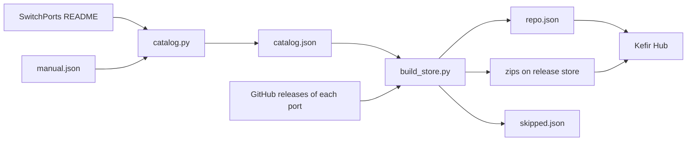

# Emu Radar Store

An App Store source for Kefir Hub. It lists Switch ports, recompilations and decompilations from the
community list [ChanseyIsTheBest/SwitchPorts](https://github.com/ChanseyIsTheBest/SwitchPorts).
Every entry has the category `port`.

The store ships only the `.nro` file of each port. Game files, ROMs and assets stay the user's job.

## Files

| File | Written by | Purpose |
|---|---|---|
| `catalog.py` | script | Reads the SwitchPorts README and writes `catalog.json`. |
| `build_store.py` | script | Reads `catalog.json`, finds the Switch build of each entry, writes `repo.json` and `skipped.json`. |
| `manual.json` | you | Optional. Adds entries or overrides fields of parsed entries. |
| `catalog.json` | workflow | One entry per port repo. Read by the digest bot and the radar. |
| `repo.json` | workflow | The store. Kefir Hub reads this file. |
| `skipped.json` | workflow | Entries with no usable Switch `.nro`, with the reason. |
| `.github/workflows/store.yml` | you | Runs both scripts daily and commits the three JSON files. |
| `tests/` | you | Offline unit tests. `tests/fixtures/switchports_readme.md` is a saved copy of the README. |

Zips are not in git. They are assets of the GitHub release `store` in this repository.

## Flow



## Use in Kefir Hub

The default source is:

```
https://raw.githubusercontent.com/<owner>/emuradar-store/main
```

Kefir Hub reads `repo.json` from that address. Each package has a `download` field with the
full URL of its zip on release `store`, so the zips do not need a `zips/` folder in git.

## Build by hand

```
python catalog.py
python build_store.py --repo <owner>/emuradar-store
python build_store.py --no-upload --out out/      # zips only, for local tests
python build_store.py --no-upload --limit 12 --out out/
```

`build_store.py` uses `GITHUB_TOKEN` when it is set. The anonymous API limit is 60 calls per hour.

Tests run offline:

```
python -m unittest discover -s tests
```

## How a package is built

1. Read the latest release. If the repo has no stable release, use the newest release, pre-releases
   included. Drafts are skipped.
2. Pick the `.nro`. A bare `.nro` asset wins. Otherwise the `.zip` assets are opened over HTTP Range
   requests, so only the central directory and the chosen `.nro` are downloaded.
3. Write a mini zip: `switch/<name>/<file>.nro`, `manifest.install` and `info.json`. Nothing else.
4. Skip and log the reason when there is no `.nro`, only `.7z`, `.rar` or `.tar` archives, or a rate limit.

A package whose tag did not change and whose zip is still on release `store` is not rebuilt.

## Add a manual entry

`manual.json` is a list. Every item needs `repo` (`owner/name`). Other keys are optional:
`title`, `section`, `version_hint`, `description`, `details`, `icon`, `license`, `url`, `binary`, `author`,
and `disabled`.

```json
[
  {"repo": "someone/some-port", "title": "Some Port", "section": "PC", "description": "Port of Some Game."},
  {"repo": "someone/unwanted-row", "disabled": true}
]
```

A manual entry replaces the parsed fields of the same repo. A repo that is not in SwitchPorts is added.
`name` cannot be set by hand. It comes from the repo name.

`"disabled": true` drops the repo from `catalog.json`, so it leaves `repo.json` on the next run. The
zip of a dropped package stays on release `store`; it is not deleted. `"disabled": false` has no effect.
The rutracker bot adds rows with only `repo` (see the bot's `add_release.py`). A row it adds never
changes `section` or `title` of a repo that SwitchPorts already lists.

## catalog.json

```json
{
  "source": "https://raw.githubusercontent.com/ChanseyIsTheBest/SwitchPorts/main/README.md",
  "rows_without_github_link": 1,
  "duplicate_rows": 1,
  "entries": [
    {
      "name": "dolphin-nx",
      "title": "Dolphin",
      "repo": "NaGaa95/dolphin-nx",
      "section": "Emulators",
      "version_hint": "1.0.0"
    }
  ]
}
```

| Field | Meaning |
|---|---|
| `name` | Unique slug `[a-z0-9_-]`. From the repo name. On a clash, the owner is added to both names. |
| `title` | From the README. Derived from the repo name when the README cell is empty. |
| `repo` | GitHub `owner/name`, as first written. Deduplicated case-insensitively. |
| `section` | README section, for example `Android` or `PC`. |
| `version_hint` | Version text from the README. It is not used for the store. |

Entries are sorted by `name`. The file has no timestamp, so a diff shows only real changes.

## Single writer

The workflow `store.yml` is the only writer of `catalog.json`, `repo.json` and `skipped.json`.
Other tools (the rutracker bot, Emu Radar) only read these files. Do not edit them by hand.
Changes to the scripts or `manual.json` go through a commit. The next run then updates the files.

## Workflow setup

1. Create the repository `<owner>/emuradar-store` on GitHub and push `main`.
2. Run the workflow once with **Run workflow**. It creates release `store` and uploads the zips.
3. Check `repo.json`: each `download` URL must open.
